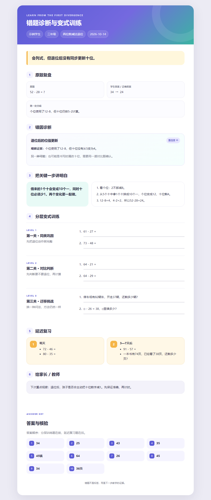

# 错题诊断与变式训练 Skill

把学生的一道错题，转化为“定位错因 → 讲明关键一步 → 分层变式 → 延迟复习”的完整训练闭环。



## 核心能力

- 定位解题过程中的第一处分歧，避免把连锁错误误判为根因
- 使用可观察证据区分位值、退位、运算选择、步骤顺序、单位、审题等错误
- 以高、中、低置信度表达诊断，不凭一道题给学生贴标签
- 生成同类巩固、对比判断、迁移挑战和延迟复习题
- 对所有生成题进行答案、唯一性、年级范围和目标技能核验
- 输出孩子版讲解、家长/教师观察建议和独立答案页
- 生成适合电脑、手机和 A4 打印的中文 HTML 报告

## 使用方式

把本仓库作为 Skill 安装后，可以直接提出类似请求：

```text
孩子三年级，原题是 52-28，答案写成34。
请判断错因，给孩子重新讲解，并生成一组变式训练和复习题。
```

需要生成漂亮的打印报告时，先按 `references/report-schema.md` 创建 JSON，然后执行：

```text
python scripts/render_report.py report.json report.html
```

渲染脚本仅使用 Python 标准库，不需要额外安装依赖。

## 目录结构

```text
wrong-answer-diagnostic-trainer/
├── SKILL.md
├── agents/openai.yaml
├── assets/icon.svg
├── references/
│   ├── diagnostic-taxonomy.md
│   ├── variation-design.md
│   └── report-schema.md
├── scripts/render_report.py
├── sample-report.json
├── sample-report.html
└── sample-report.png
```

## 设计边界

- 单道错题只能形成待验证的诊断假设，不能据此判断学生的稳定能力或态度。
- 不使用“粗心”“基础差”“不认真”等人格化标签。
- 学习障碍、注意力障碍或其他医学判断不属于本 Skill 的能力范围。
- 在正式使用生成题前，教师或家长仍应结合教材版本和学生实际情况复核。

## 当前状态

首个可测试版本。已完成结构、示例数据、答案数量、渲染脚本和浏览器显示检查。

Copyright © 2026. All rights reserved.

